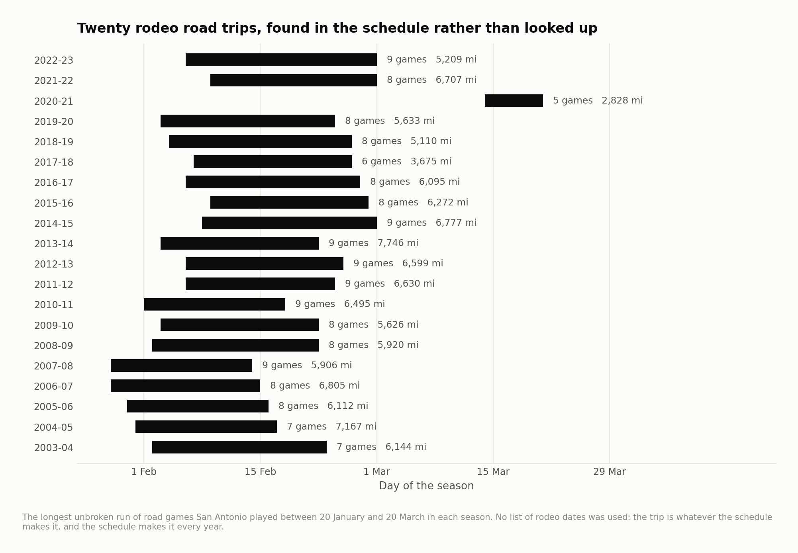
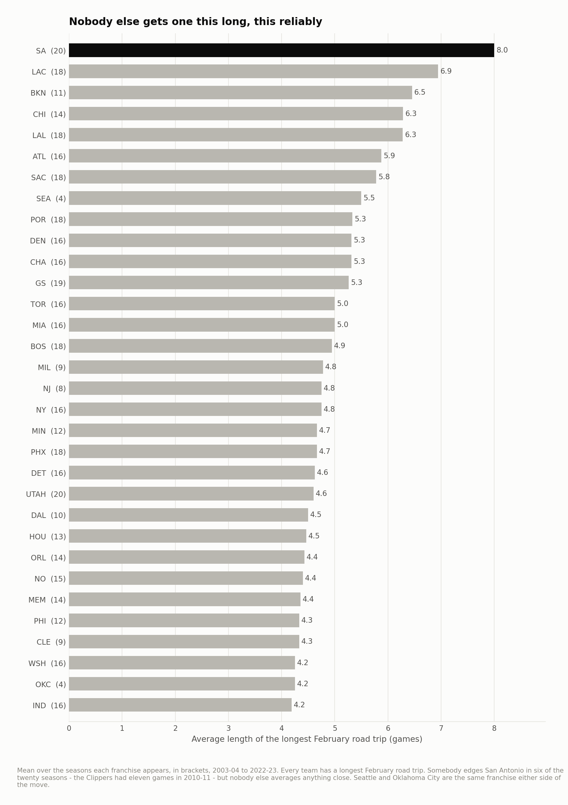
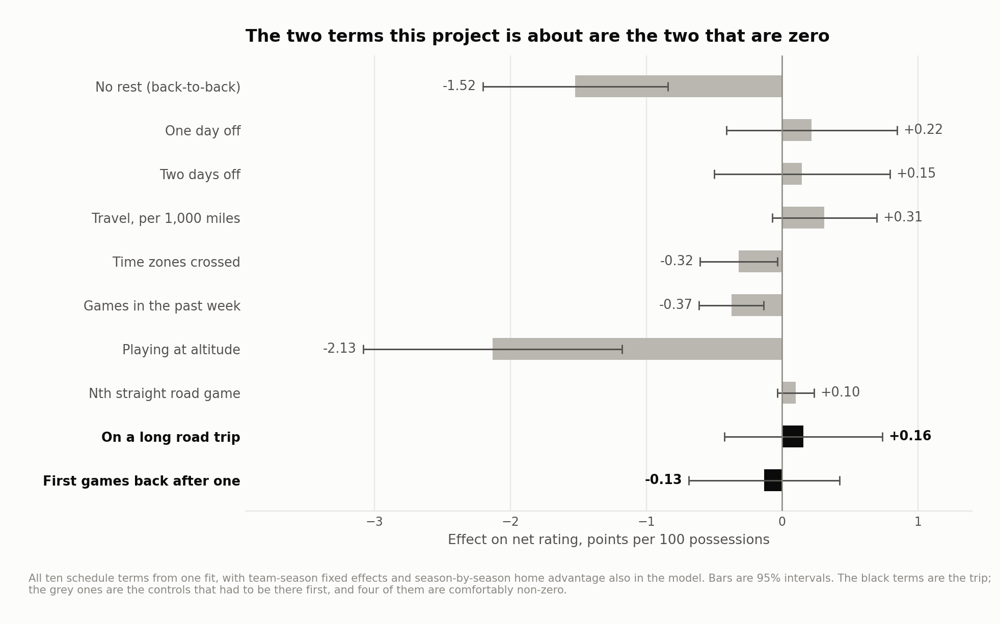
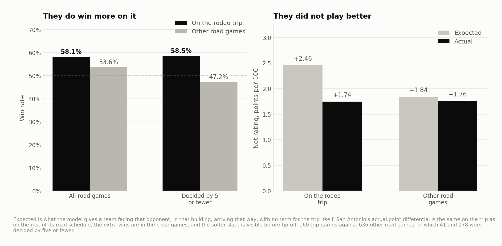
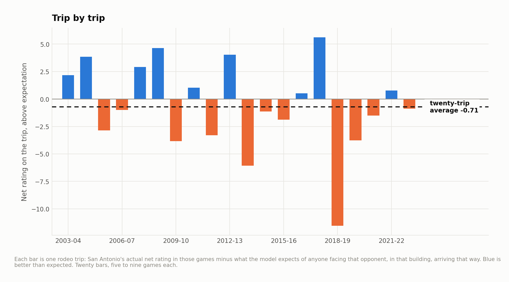

# The Rodeo Road Trip

Every February the stock show and rodeo takes over the arena in San Antonio and
the Spurs leave town for two and a half weeks. It has happened every season
since 2003. The Clippers and Lakers have their own version around the Grammys;
San Antonio's is a game longer on average than anyone else's and has run without
interruption for twenty years. It also comes with a piece of folklore attached:
that the Spurs are *better* on it.

Twenty seasons of schedules and box scores, 23,838 games, 2003-04 to 2022-23.

**They win more on it. They do not play better on it. Both of those are true,
and the gap between them is the schedule.**

---

## Finding the trip

Nothing in the schedule data says "rodeo road trip". So it is not looked up, it
is detected: for each team and season, the longest unbroken run of road games
whose **first** game falls between 20 January and 20 March, discarded if it is
shorter than four games.

For every other franchise it returns whatever the schedule maker happened to
hand them. For San Antonio it returns the rodeo, twenty times out of twenty.



**Twenty trips, averaging 8.0 games over 18.8 days and 5,973 miles.** The
longest were nine games. The odd one out is 2020-21, five games in March, from
the compressed season the pandemic rearranged — which the detector found without
being told anything about it.

Three of the twenty were checked against contemporaneous reporting rather than
against the data that produced them: the 2016-17 start date and the 2018-19 end
date match exactly, and eight of the nine opponents the detector found for
2022-23 are the eight a season-preview piece listed. It is the right event.

And it really is unique:



| Team | Average longest February trip |
|---|---|
| **San Antonio** | **8.00 games** |
| LA Clippers | 6.94 |
| Brooklyn | 6.45 |
| Chicago | 6.29 |
| LA Lakers | 6.28 |
| ... | |
| Washington | 4.25 |
| Oklahoma City *(4 seasons)* | 4.25 |
| Indiana | 4.19 |

A full game longer, on average, than any other franchise. Not in every single
season — the Clippers had an eleven-game trip in 2010-11, and somebody edges San
Antonio in six of the twenty — but no other franchise gets one this long this
reliably, and none of the others is the same event twice.

Widen the detection window to the whole of January through mid-April and San
Antonio's number does not move: 8.00 games, twenty seasons. The rodeo trip is
not just their longest February road trip, it is their longest road trip of the
second half of the season, every year.

---

## Does a long trip cost anything?

The first question is whether the trip is a burden at all beyond the ordinary
road games inside it. Put an indicator for "the away team is on its long
February trip" into a model that already has team-season fixed effects,
season-by-season home advantage, and controls for rest, back-to-backs, density,
travel, time zones and altitude:



| | Points per 100 | Std. error | t |
|---|---|---|---|
| On a long road trip | +0.16 | 0.30 | 0.5 |
| First games back after one | −0.13 | 0.28 | −0.5 |

Nothing, in either direction. A long trip is not a special burden. It is eight
road games, and the model has already priced eight road games — the rest, the
miles, the time zones and the density are in there individually, and once they
are, the fact that they came in a row adds nothing measurable.

That is a useful null, and it is worth reading next to the terms around it. The
same fit puts a back-to-back at −1.52 and a night in Denver or Salt Lake City at
−2.13, both comfortably away from zero. The instrument finds things. The trip is
not one of them.

The much-discussed hangover in the first games back is not there either, but
that one is a much softer null and the README should not pretend otherwise.
"First games back" has to be defined, and the estimate follows the definition:
three games gives −0.55, five games −0.19, and matching the length of the trip
itself −0.13. Across the nine specifications in `output/sensitivity.csv` it runs
from −0.55 to +0.54. None of them is significant and the spread is wider than
any of the estimates, which is the honest reading: twenty trips cannot resolve a
hangover of half a point per 100 from nothing.

---

## So why do they win on it?

They do win on it. Over 160 rodeo-trip games:



| | Games | Win rate | Actual net | Expected net |
|---|---|---|---|---|
| **On the rodeo trip** | 160 | **58.1%** | +1.74 | +2.46 |
| Other road games | 636 | 53.6% | +1.76 | +1.84 |
| Home games | 794 | 73.8% | +7.82 | +7.60 |

Four and a half percentage points better on the trip than on their other road
games. That is the folklore, and it is in the data.

Two things sit underneath it, and neither is the story anyone tells.

**They did not outplay anyone.** Their point differential on the trip is +1.74
per 100. On the rest of their road schedule it is +1.76. The same, to within a
rounding error, across 160 games and 636. The extra wins are not extra
production; they are the same production landing on the right side of more close
results. In games decided by five points or fewer they went 58.5% on the trip
and 47.2% on other road nights — an eleven-point swing on a sample of 41 games,
which is what a coin looks like when you only flip it forty times.

**The trip is a softer slate.** The model's expectation for a Spurs trip game is
+2.46 points per 100; for their other road games it is +1.84. Roughly a third of
that 0.6 is the opponents: a two-week block has to be assembled out of whoever
happens to be at home, and it disproportionately reaches the eastern conference
— 50% of their trip opponents against 33% of their other road opponents. The
rest is the schedule terms, mostly the model's small positive coefficient on how
deep into a road trip a team is, which the sibling schedule project fits too and
explicitly does not believe. Strip that term out and the slate advantage halves
to 0.33 and the conclusion below does not move.

Put the two together and San Antonio was **0.71 points per 100 worse than
expected on the trip**, with a 95% interval running from −2.65 to +1.31 and
p = 0.48. Not measurably different from ordinary, and if anything pointed the
wrong way.



---

## Why this is a small project with a specific point

The interesting thing here is not the answer, which is a null. It is that a
twenty-year piece of institutional folklore, repeated by broadcasters every
February, rests entirely on a comparison nobody adjusted — and that when you do
adjust it, the correction has two independent pieces, one about who they played
and one about how close the games were, and neither has anything to do with what
the story claims.

The win rate is real. The inference from it is not. And the corrections take
things any model of team performance already has to have for other reasons.

That pattern is most of what a schedule analysis is for.

---

## How the model works

One row per game, from the home team's side. The outcome is home net rating,
points per 100 possessions minus points allowed per 100.

```
net_home  =  strength(home team, that season)
           − strength(away team, that season)
           + home advantage for that season
           + rest, travel, density, time zones, altitude
           + the trip indicators
           + error
```

R² 0.229, residual standard deviation 12.3 points per 100 across 23,838 games.
The schedule controls come out where an independent fit of the same model puts
them — a back-to-back at −1.52, playing at altitude at −2.13, each additional
game in the trailing week at −0.37 — which is the cross-check that the trip term
is being read off a model that works.

Team-season fixed effects mean a schedule coefficient is identified from
variation inside a single roster's own season. The 2019-20 restart is excluded
rather than averaged in: twenty-two teams in one Florida complex with no travel
is neither a road trip nor a home stand.

"Expected", everywhere above, deliberately leaves the two trip indicators out of
the fitted value. Including them would make the comparison circular — the
residual would already have the league-wide trip effect removed, and "San
Antonio against expectation" would quietly become "San Antonio against other
teams on trips".

`output/sensitivity.csv` refits the whole thing under seven definitions of the
trip. The window, the minimum length and the control set all move the estimates
by less than their standard errors. `docs/method.md` has that table and the
detection rule in full.

---

## What this does not do

- **No injury or rest data.** If the Spurs used the trip to rest players — which
  they were famous for — that is inside the estimate, not controlled for. The
  null is "no effect after everything the schedule can see", and roster
  decisions are not something the schedule can see.
- **The All-Star break is inside seventeen of the twenty trips** and the model
  has no term for it. A trip interrupted by five days off is not quite the same
  object as one that is not.
- **Twenty trips is twenty observations.** The estimates use 160 games, but
  games inside one trip are not independent of each other.
- **Possessions are estimated** from the box score with the usual
  FGA + 0.44×FTA − OREB + TOV. Fine over a whole game, not fine over a quarter.
- **2022-23 is the last season**, which is where the public mirror this reads
  currently ends.
- **Regular season only.**

---

## Running it

```bash
pip install -r requirements.txt
python src/run_01_build.py   # schedules + box scores -> the team-game panel
python src/run_02_trips.py   # detect the trips, price them, figures 01-05
```

Or `make all`. Under a minute.

```
src/
  config.py      paths, seasons, the detection window
  venues.py      every city the league played in, with elevation and time zone
  model.py       the design matrix and the estimator
  trips.py       finding the trip, labelling the games, the bootstrap
  labels.py      collision-resolving point labels
  style.py       one place that decides what every figure looks like
  run_0*.py      the pipeline, in order
output/          every number quoted above, as CSV
figures/         five figures, regenerated from scratch by the pipeline
docs/method.md   longer notes, including the detection rule in full
```

## Data

Schedules and team box scores from
[sportsdataverse/hoopR-data](https://github.com/sportsdataverse/hoopR-data),
a mirror of ESPN's public feeds. `data/README.md` has the fetch step.

## License

MIT. See `LICENSE`.
